# 🕸️ خريطة المعمارية الشاملة لمنصة PR Agent (Architecture Map)

## 📌 نظرة عامة على تدفق النظام (System Architecture Graph)

```mermaid
graph TB
    %% ================= FRONTEND LAYER =================
    subgraph Frontend["💻 Frontend Layer (Next.js 16 + React 19)"]
        LP["Landing Page (/)"]
        INBOX["Omnichannel Inbox (/inbox)"]
        CRM["Sales Pipeline (/pipeline)"]
        FLEET["Agents Fleet (/fleet)"]
        FLOWS["Typebot Flows (/flows)"]
        SETTINGS["Enterprise Settings (/settings)"]
        PRICING["Pricing & ROI (/pricing)"]
    end

    %% ================= BACKEND & WEBHOOKS =================
    subgraph Backend["⚙️ Backend API & Webhooks (/api)"]
        WH_META["/api/webhooks/meta (IG & WA)"]
        WH_EVO["/api/webhooks/whatsapp-evolution"]
        WH_CHATWOOT["/api/webhooks/chatwoot"]
        API_CHAT["/api/chat"]
        API_ORDERS["/api/orders/extract"]
        API_PAYMENTS["/api/payments/verify"]
        API_SETTINGS["/api/settings/config"]
    end

    %% ================= AI INTELLIGENCE =================
    subgraph AI["🧠 AI & Moderation Layer"]
        MOD["AI Moderator (Toxic/Spam Guard)"]
        ROUTER["Smart Multi-LLM Router"]
        AGENTS["10 Autonomous Agents Fleet"]
        VISION["InstaPay Receipt Vision Engine"]
    end

    %% ================= DATA & PERSISTENCE =================
    subgraph DB["🗄️ Persistence & Storage (Supabase)"]
        CUSTOMERS[("customers (CRM Leads)")]
        CONVERSATIONS[("conversations (Threads)")]
        MESSAGES[("messages (Chat History)")]
        TENANTS[("tenants (Stores & Settings)")]
        STORAGE[("Signed URLs Storage (Receipts)")]
    end

    %% ================= EXTERNAL SERVICES =================
    subgraph External["🌐 External Integrations & APIs"]
        META["Meta Graph API (Instagram/WhatsApp)"]
        EVO_SRV["Evolution API (QR WhatsApp Server)"]
        CHATWOOT_CORE["Chatwoot Core Engine"]
        GEMINI["Google Gemini 1.5 Flash (Vision + Reasoning)"]
        GROQ["Groq Llama 3.1 (Fast 0$ Fallback)"]
    end

    %% Connections
    META -->|Webhooks| WH_META
    EVO_SRV -->|Webhooks| WH_EVO
    CHATWOOT_CORE -->|Webhooks| WH_CHATWOOT

    WH_META --> MOD
    WH_EVO --> MOD
    WH_CHATWOOT --> MOD

    MOD --> ROUTER
    ROUTER --> GEMINI
    ROUTER --> GROQ
    ROUTER --> AGENTS

    AGENTS -->|Inbound / Outbound| CONVERSATIONS
    AGENTS -->|Persist Chats| MESSAGES
    WH_META -->|Create Lead| CUSTOMERS
    WH_EVO -->|Create Lead| CUSTOMERS

    API_PAYMENTS --> VISION
    VISION --> GEMINI
    VISION --> STORAGE

    INBOX --> CONVERSATIONS
    INBOX --> MESSAGES
    CRM --> CUSTOMERS
    CRM --> CONVERSATIONS
    SETTINGS --> TENANTS
```

---

## 🗂️ فهرس المكونات والمسارات البرمجية

| الطبقة | المسار / الملف | الوظيفة الأساسية |
| :--- | :--- | :--- |
| **Frontend** | `src/app/page.tsx` | الصفحة الرئيسية بهوية Dark Void، محاكي الـ Inbox، وشهادات العملاء |
| **Frontend** | `src/app/inbox/page.tsx` | صندوق الوارد الموحد لمحادثات واتساب وإنستجرام مع التدخل البشري الفوري |
| **Frontend** | `src/app/pipeline/page.tsx` | لوحة كانبان لإدارة العملاء من تعليق إنستجرام حتى تسليم الأوردر |
| **Frontend** | `src/app/fleet/page.tsx` | لوحة تحكم ومراقبة أداء الإيجنتس العشرة المستقلين |
| **Frontend** | `src/app/flows/page.tsx` | محاكي المسارات التفاعلية لاختيار المقاسات والسلات المتروكة (Typebot) |
| **Frontend** | `src/app/settings/page.tsx` | إعدادات الـ API Key، وحفظ الـ Webhook URL، واختبار الـ Ping |
| **Backend API**| `src/app/api/webhooks/meta/route.ts` | استقبال تعليقات إنستجرام ورسائل واتساب الرسمية مع التحقق الأمني HMAC |
| **Backend API**| `src/app/api/webhooks/whatsapp-evolution/route.ts` | استقبال رسائل واتساب عبر QR Code من Evolution API بدون شروط Meta |
| **AI Layer** | `src/lib/llmRouter.ts` | الموزع الذكي بين Gemini 1.5 و Groq Llama 3.1 ونظام الطوارئ المحلي |
| **AI Layer** | `src/lib/aiModerator.ts` | صمام الأمان لفلترة الـ Prompt Injection، الألفاظ البذيئة، وسبام الروابط |
| **Automation**| `src/lib/instagramAutomation.ts` | محرك التعليقات لتحويل المعلقين إلى مشترين عبر رسائل الـ DM الخاصة فوراً |
| **Database** | `src/lib/supabaseClient.ts` | الربط الإداري الآمن مع جداول العملاء، المحادثات، الرسائل، والمتاجر |
