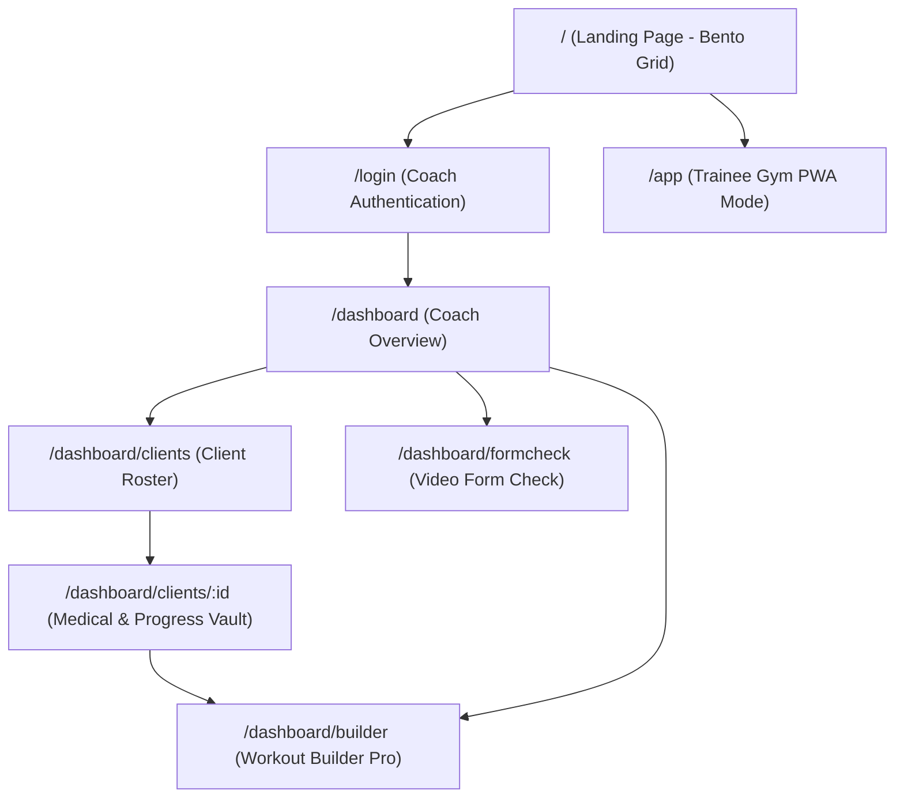
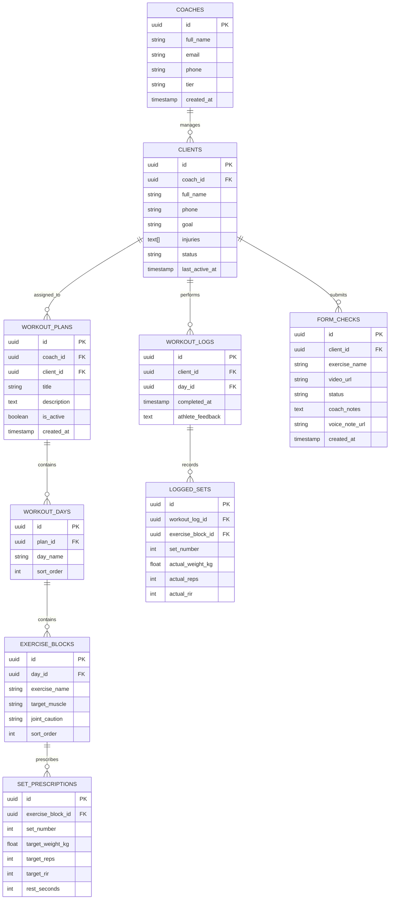

# 🎨 CoachPRB - System Design & Architecture Specification (`design.md`)

> **Platform:** CoachPRB (كوتش بي آر بي)  
> **Aesthetic:** Dark Luxury Bento Grid / Minimalist Cyber-Strength  
> **Color System:** Deep Obsidian (`#07040D`), Rich Void (`#0B0714`), Electric Violet (`#7C3AED`), Emerald Glow (`#10B981`), Crimson Alert (`#EF4444`)  
> **Typography:** Arabic primary font (Cairo / Readex Pro / IBM Plex Sans Arabic fallback) with Geist / Inter for English digits and metrics.

---

## 🎨 1. UI/UX Design System & Tokens

### Color Palette
| Token | Hex | Usage |
| :--- | :--- | :--- |
| `bg-primary` | `#07040D` | Main canvas, global dark background |
| `bg-surface` | `#110B1F` | Bento cards, glass modals, elevated surfaces |
| `border-subtle` | `rgba(255, 255, 255, 0.08)` | Bento container borders with 1px hairline |
| `accent-purple` | `#7C3AED` | Primary CTA buttons, brand badges, active tab glow |
| `accent-glow` | `#9061F9` | Hover states, neon border gradients |
| `status-success` | `#10B981` | Completed sets, PR records, healthy client status |
| `status-warning` | `#F59E0B` | RIR 0 (Failure), check-in pending |
| `status-danger` | `#EF4444` | Churn risk (>= 5 days missed), joint injury alerts |

### Bento Grid Philosophy
- All cards share `rounded-2xl border border-white/10 bg-[#110B1F]/60 backdrop-blur-xl`.
- Subtle radial glow effects centered behind primary hero metrics.
- High-contrast typography optimized for dimly lit gym environments and OLED mobile screens.
- Generous tap targets (minimum 48x48px) for quick input while wearing lifting straps or wraps.

---

## 🏗️ 2. Information Architecture & Navigation

---

## 🗄️ 3. Database Schema (Supabase / PostgreSQL)

### ERD Diagram

---

## ⚡ 4. Offline Service Worker & Sync Protocol
1. **App Shell Caching:** All Next.js static chunks, `/`, `/dashboard`, `/dashboard/builder`, and `/app` are pre-cached on PWA registration.
2. **Offline Mutation Queue:** In-gym logged sets write immediately to local storage (`localStorage` / `IndexedDB`).
3. **Background Sync:** The service worker intercepts network recovery (`window.addEventListener('online')`), flushes cached sets to `/api/logs/sync`, and displays a toast confirmation to the athlete.
