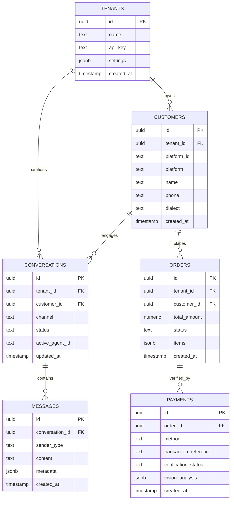

# Floorplan: 03-Database (Supabase PostgreSQL Schema & Security)

```
[Founder Suite: Active] | [Floorplan: Active]
Scope: Relational Database, Row Level Security (RLS) & State Persistence
Repository: coach-pr (PR Agent Pure Edition)
Status: Operational
```

---

## 1. Schema Topology

The persistence layer is hosted on Supabase (PostgreSQL 15+), architected around multi-tenant isolation, real-time subscriptions, and fast indexed lookups across customer conversations.

### Core Tables



---

## 2. Row Level Security (RLS) Policies

All tables enforce strict PostgreSQL Row Level Security:
1. **Tenant Isolation**: Every query automatically evaluates `tenant_id = auth.jwt() ->> 'tenant_id'`.
2. **Service Role Access**: Webhook receivers and background routing workers utilize the Supabase `SERVICE_ROLE_KEY` to write normalized records across tenants securely.
3. **Audit Trails**: Updates on `orders` and `payments` trigger immutable audit logs in `audit_events`.

---

## 3. High-Performance Indexing Strategy

- `idx_conversations_tenant_status`: `(tenant_id, status)` for instant inbox filtering.
- `idx_messages_conversation_created`: `(conversation_id, created_at DESC)` for sub-millisecond chat thread loading.
- `idx_customers_platform_lookup`: `(tenant_id, platform, platform_id)` for zero-latency customer resolution on incoming webhooks.
