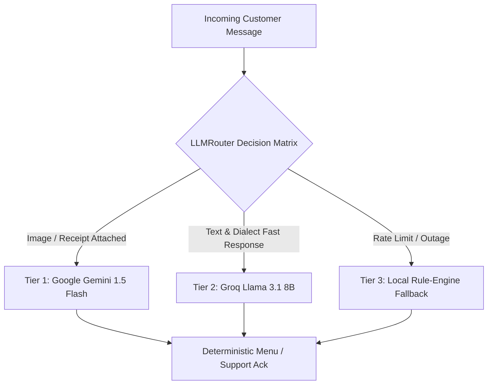

# Floorplan: 04-AI-Layer (LLM Router, Multi-Agent Fleet & Guardrails)

```
[Founder Suite: Active] | [Floorplan: Active]
Scope: AI Orchestration, Dialect Understanding, Vision Analysis & Guardrails
Repository: coach-pr (PR Agent Pure Edition)
Status: Operational
```

---

## 1. 3-Tier Multi-Provider LLM Router (`src/lib/llmRouter.ts`)

To balance cost, latency, and capabilities, PR Agent implements an intelligent routing layer across three specialized tiers:



### Tier Specifications
1. **Tier 1 (Vision Tasks)**:
   - Model: `gemini-1.5-flash` via `@google/generative-ai`.
   - Primary duty: InstaPay screenshot verification, Vodafone Cash SMS OCR, defective product image analysis.
2. **Tier 2 (High-Speed Conversational)**:
   - Model: `llama-3.1-8b-instant` via Groq Cloud.
   - Primary duty: Sub-300ms Egyptian dialect dialogue, objection handling, and product recommendation.
3. **Tier 3 (Local Deterministic Fallback)**:
   - Local TypeScript pattern-matching and state-machine transitions when upstream APIs are unreachable.

---

## 2. Autonomous Agent Fleet (`src/data/agents.ts`)

PR Agent deploys a coordinated fleet of 10 specialized agent personas:
1. **Comment Hunter**: Detects high-intent comments on Instagram/Facebook posts and initiates DM conversion.
2. **Conversation Concierge**: Manages greetings, identifies returning clients, and routes dialogue.
3. **Product Specialist**: Answers sizing, availability, color variants, and technical specs.
4. **Order Negotiator**: Handles discounts within merchant-set bounds and closes deals.
5. **Checkout Closer**: Collects shipping addresses, phone numbers, and payment selections.
6. **Payment Validator**: Processes InstaPay and mobile wallet receipts using visual OCR.
7. **Post-Purchase Follower**: Dispatches tracking numbers and delivery notifications.
8. **Feedback & Review Collector**: Solicits ratings and positive reviews on completed deliveries.
9. **Escalation Sentinel**: Identifies angry customers or complex queries and hands off to human agents.
10. **Re-engagement Retargeter**: Re-activates abandoned carts after 2 and 24 hours.

---

## 3. Moderation & Guardrails (`src/lib/aiModerator.ts`)

- **Prompt Injection Defense**: Sanitizes user inputs against delimiter manipulation and role-override commands.
- **Competitor Redaction**: Blocks unauthorized promotions or links to rival platforms.
- **Profanity & Sentiment Filtering**: Escalates toxic discourse to human moderation with priority flags.
