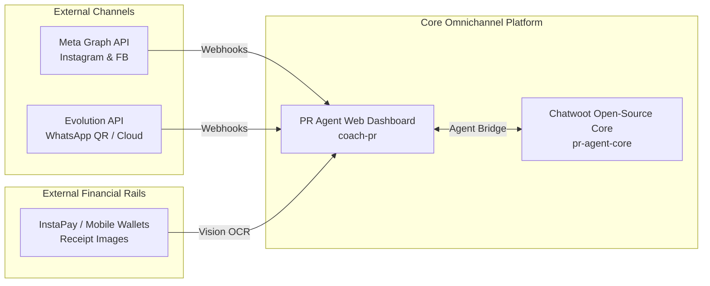

# Floorplan: 05-Integrations (Meta, Evolution API, Chatwoot & Payments)

```
[Founder Suite: Active] | [Floorplan: Active]
Scope: External Channel Ingestion, Omnichannel Core & Payment Verifications
Repository: coach-pr (PR Agent Pure Edition)
Status: Operational
```

---

## 1. External Integration Topology



---

## 2. Channel Specifications

### 2.1 Meta Graph Integration (Instagram / Facebook Messenger)
- **Permissions Required**: `instagram_manage_messages`, `pages_manage_metadata`, `pages_read_engagement`.
- **Comment-to-DM Engine**:
  - Webhook listener captures `feed` and `mentions` webhooks.
  - Generates automated comment reply ("تم إرسال التفاصيل في الخاص 📩") and immediately creates a DM thread with product details.

### 2.2 Evolution API (WhatsApp Multi-Device)
- **Deployment**: Self-hosted Docker instance managing headless Baileys sessions.
- **QR Code Pairing**: Direct pairing via `/settings` UI without requiring expensive WhatsApp Cloud API template fees.
- **Audio Note Transcriptions**: Incoming voice notes automatically converted to text via Groq Whisper API for AI agent processing.

### 2.3 Chatwoot Core Integration
- **Role**: Provides the industrial-grade, multi-agent human inbox backend, real-time presence indicators, and team assignments.
- **PR Agent Bridge**: Custom webhook forwarding between `coach-pr` and `pr-agent-core`, delegating automated turns to PR Agent and routing human turns to human reps.

### 2.4 Egyptian Payment OCR (InstaPay & Mobile Cash)
- **Validation Criteria**:
  - Beneficiary account name matching.
  - Transaction reference uniqueness (preventing screenshot reuse).
  - Timestamp within the last 30 minutes of checkout initiation.
  - Amount equals or exceeds order total.
