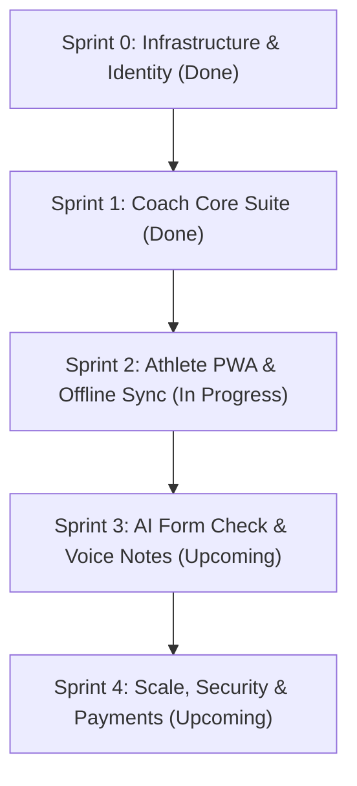

# 📋 CoachPRB - Product & Engineering Execution Plan (`plan.md`)

> **Brand Identity:** CoachPRB (كوتش بي آر بي)  
> **Slogan:** "سجّل رقمك. غيّر جسمك."  
> **Production URL:** [coachprb.vercel.app](https://coachprb.vercel.app)  
> **Framework:** Next.js 16 (App Router + Turbopack) + TypeScript + Tailwind CSS + Supabase (PostgreSQL + RLS) + PWA Offline Service Worker  

---

## 🎯 1. Mission & Vision
CoachPRB is a B2B SaaS online coaching platform tailored for strength coaches, bodybuilders, and fitness professionals in the Middle East and Egypt. It replaces disorganized WhatsApp and Google Sheets coaching routines with a unified, dark luxury PWA supporting:
1. **Coach Command Center:** Rapid client roster management, churn risk detection, and revenue insights.
2. **Workout Builder Pro:** Exercise matrix with RIR (Reps in Reserve), tempo, joint protection warnings, and Excel copy/paste support.
3. **Form Check & Feedback Engine:** Video/media review with timestamped and voice-note coaching cues.
4. **Offline Gym PWA:** Trainee log execution without active cellular reception inside basement gym facilities.

---

## 🗺️ 2. Development Roadmap & Sprints

### ✅ Sprint 0: Foundation & Brand Identity Cleanse (Completed)
- Cleanse all legacy / unrelated project references (no "PR Agent").
- Deploy PWA manifest with Arabic localization: `name: "CoachPRB - سجل رقمك. غير جسمك"`.
- Dark Luxury Bento Grid landing page on `/` with deep purple `#7C3AED` and rich black `#07040D`.
- Service worker implementation (`public/sw.js`) with stale-while-revalidate strategy.

### ✅ Sprint 1: Coach Core Suite (Completed)
- **Dashboard (`/dashboard`):** Active client count, churn risk flags (clients with >= 5 inactive days), and monthly revenue forecast.
- **Client Management (`/dashboard/clients`):** Roster table, quick client add modal, medical injury flags, and single client overview (`/dashboard/clients/[id]`).
- **Workout Builder Pro (`/dashboard/builder`):**
  - Categorized exercise modal with 18+ compound/isolation movements.
  - Multi-set parameters: Weight (kg), Reps, RIR (0-4), Rest timer (sec).
  - Joint safety badge alerts (Lumbar spine, Patellar tendon, Rotator cuff).
  - Dynamic route wrapped in React `<Suspense>` for Next.js 16 build safety.

### 🟡 Sprint 2: Athlete Execution Experience & Excel Importer (In Progress)
- **Trainee PWA View (`/app`):** Distinct view for athletes opening the app at the gym.
  - View assigned daily workout from coach.
  - Big tap targets for logging weight/reps with chalk-covered gym hands.
  - Auto-timer rest counter with audio chime.
  - IndexedDB local queue syncing to Supabase when reconnected.
- **Workout Builder Excel Import:** One-click bulk paste parser converting raw table lines into builder sets.

### 🔮 Sprint 3: Video Form Check & Timestamp Voice Coaching (Upcoming)
- Client video upload for squat, bench, deadlift, and overhead press.
- Frame-by-frame scrub tool with angle overlays.
- Coach audio voice notes recorded directly in browser and pinned to exact video timestamps.
- AI failover assistant checking for bar-path divergence.

### 🔮 Sprint 4: Growth, Billing & Enterprise WhatsApp Hooks (Upcoming)
- Localized payment gateways: Paymob / Fawry / Stripe for regional coach subscriptions.
- Automated WhatsApp notifications via Evolution API / Cloud API for check-in reminders.
- Multi-coach gym management & white-label team branding.

---

## 🛡️ 3. Definition of Done (DoD)
1. **Zero Brand Leakage:** No external labels in code or client-facing strings.
2. **Build Integrity:** `npm run build` must compile 100% cleanly without TypeScript or static generation errors.
3. **Database Security:** Every table must have Row-Level Security (RLS) active and mock fallbacks for zero-crash demo mode.
